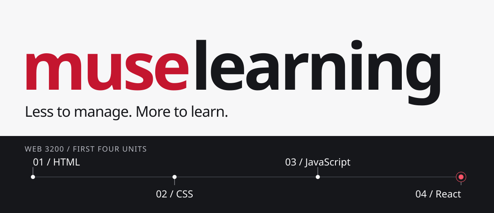

# muselearning

My professor told me to not use AI for coding so I created course project to demonstrate the AI capabilities.  

## Built with

Next.js, React, TypeScript, Tailwind CSS, Zustand, Motion, and Phosphor icons.

